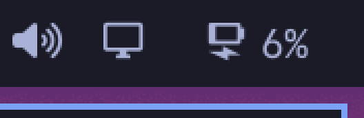

**English** | [Русский](#русский)

# Power: horizontal battery for the Omarchy bar

A drop-in replacement for Omarchy's built-in power widget (`omarchy.power`) that
draws the battery **horizontally** and puts the remaining charge **to the right
of the icon**.



- **Horizontal icon.** Material's `md-battery` glyphs are vertical, so the glyph
  is turned a quarter turn: the terminal ends up on the right and the charge
  fills from the left, like a real battery.
- **Ten levels.** The stock `md-battery` set is kept, so the icon steps through
  ten fill levels rather than five.
- **Charge to the right.** `88%` is drawn after the icon at the bar's body size
  (`Style.font.body`), not inside the rotated glyph.
- **Right-click** toggles the percentage on and off; the choice is kept in
  `shell.json` as `showPercentage`.
- **Russian labels** in the panel: `От батареи`, `Зарядка`, `Порог`,
  `Полностью заряжена`, plus the charging phrases.

## Install

```bash
omarchy plugin add https://github.com/Mystical89/mystical-power.git --enable
```

The plugin keeps the id `mystical.power`, so a bar entry that already points at
the old clone keeps working. If you still have the stock `omarchy.power` entry
in the bar, replace its `id` with `mystical.power`.

The widget is added once; set it in the bar settings panel or in
`~/.config/omarchy/shell.json`:

```json
{ "id": "mystical.power", "showPercentage": true }
```

## Settings

| Key | Default | Meaning |
|---|---|---|
| `showPercentage` | `false` | Draw the charge next to the icon (right-click toggles it) |

Everything else — the panel with the power profile, the battery stats, the
low-charge threshold handling — is Omarchy's own code, unchanged.

## Uninstall

```bash
omarchy plugin remove mystical.power
```

Because the manifest records `clonedFrom: omarchy.power`, removing this plugin
lets Omarchy re-enable its stock widget. The bar entry stays in `shell.json`.

## How it differs from omarchy.power

| File | Change |
|---|---|
| `Panel.qml` | `BarIconButton` → `WidgetButton` with a `Row`: the rotated `OpticalGlyph` plus a `Text` for the charge. The stock code builds one string (`"88% 󰁹"`) for the glyph, which cannot work once the icon is rotated — the text would rotate too. |
| `Panel.qml` | The glyph gets `rotation: 90` inside a `Style.bar.iconCanvas` box at `Style.bar.iconFont`; the charge is drawn at `Style.font.body`; spacing and padding come from `Style.space()`. |
| `Model.js` | Icon sets untouched (ten levels); only the mode labels are Russian. |

## License

MIT — see [LICENSE](LICENSE). The original widget is Omarchy's, copyright
David Heinemeier Hansson.

---

## Русский

[↑ English](#power-horizontal-battery-for-the-omarchy-bar)

Замена штатного виджета питания Omarchy (`omarchy.power`): батарея рисуется
**горизонтально**, а остаток заряда выводится **справа от иконки**.


- **Горизонтальная иконка.** Глифы `md-battery` в Material вертикальные, поэтому
  глиф поворачивается на четверть оборота: контакт оказывается справа, а заряд
  заполняется слева — как у настоящей батареи.
- **Десять уровней.** Штатный набор `md-battery` сохранён, так что иконка
  проходит десять ступеней заполнения, а не пять.
- **Заряд справа.** `88%` рисуется после иконки кеглем тела бара
  (`Style.font.body`), а не внутри повёрнутого глифа.
- **Правый клик** включает и выключает проценты; выбор сохраняется в
  `shell.json` как `showPercentage`.
- **Русские подписи** в панели: `От батареи`, `Зарядка`, `Порог`,
  `Полностью заряжена`, а также фразы про зарядку.

### Установка

```bash
omarchy plugin add https://github.com/Mystical89/mystical-power.git --enable
```

Плагин сохраняет ID `mystical.power`, поэтому запись в баре, которая уже
указывает на старый клон, продолжает работать. Если в баре всё ещё стоит
штатная запись `omarchy.power`, замените её `id` на `mystical.power`.

Виджет добавляется один раз; настройка — в панели настроек бара или в
`~/.config/omarchy/shell.json`:

```json
{ "id": "mystical.power", "showPercentage": true }
```

### Настройки

| Ключ | По умолчанию | Смысл |
|---|---|---|
| `showPercentage` | `false` | Рисовать заряд рядом с иконкой (правый клик переключает) |

Всё остальное — панель с профилем питания, статистика батареи, обработка порога
низкого заряда — это код Omarchy без изменений.

### Удаление

```bash
omarchy plugin remove mystical.power
```

Так как в манифесте указано `clonedFrom: omarchy.power`, после удаления Omarchy
снова включит свой штатный виджет. Запись в баре остаётся в `shell.json`.

### Чем отличается от omarchy.power

| Файл | Изменение |
|---|---|
| `Panel.qml` | `BarIconButton` → `WidgetButton` с `Row`: повёрнутый `OpticalGlyph` плюс `Text` для заряда. Штатный код собирает одну строку (`"88% 󰁹"`) для глифа, что невозможно, когда иконка повёрнута — текст повернулся бы вместе с ней. |
| `Panel.qml` | Глиф получает `rotation: 90` в канве `Style.bar.iconCanvas` размером `Style.bar.iconFont`; заряд рисуется кеглем `Style.font.body`; отступы — из `Style.space()`. |
| `Model.js` | Наборы иконок не тронуты (десять уровней); по-русски только подписи режима. |

### Лицензия

MIT — см. [LICENSE](LICENSE). Исходный виджет принадлежит Omarchy, copyright
David Heinemeier Hansson.
